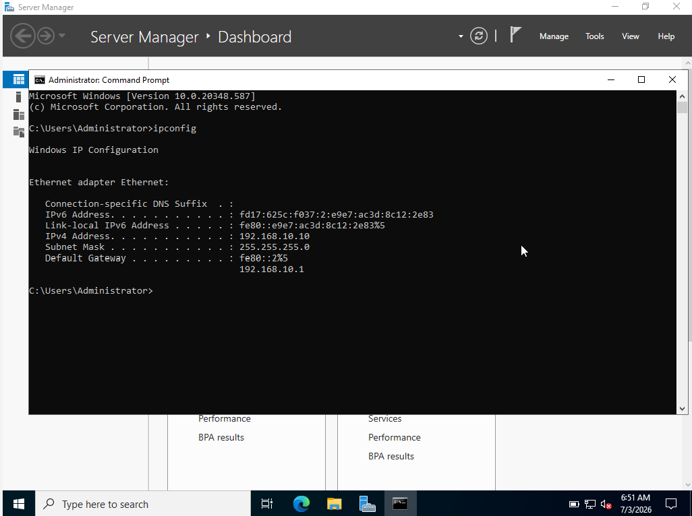
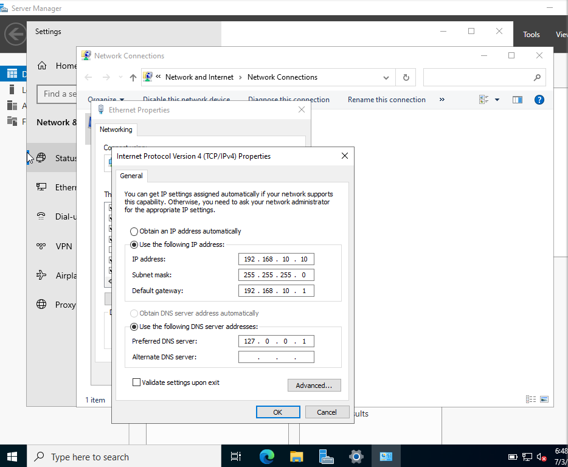
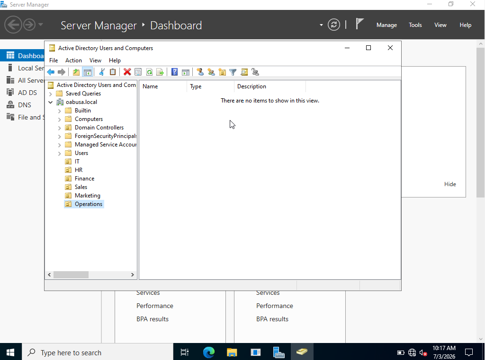
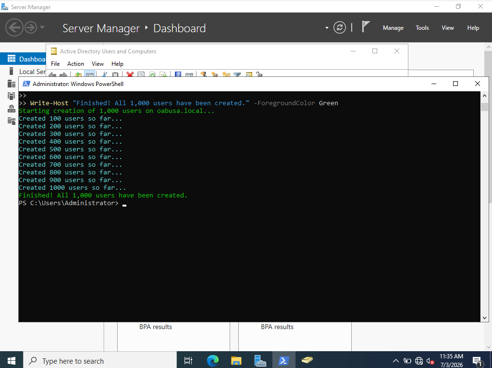
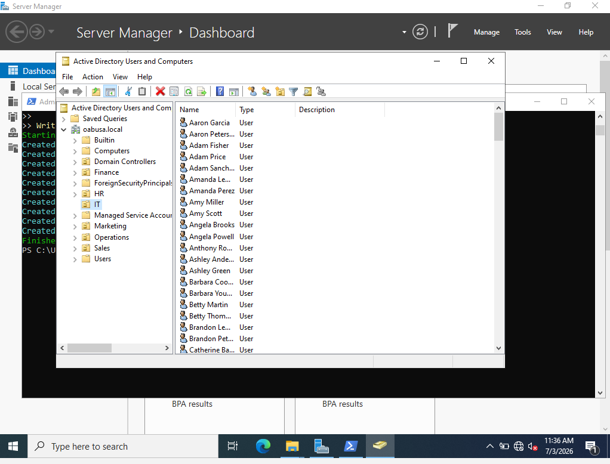
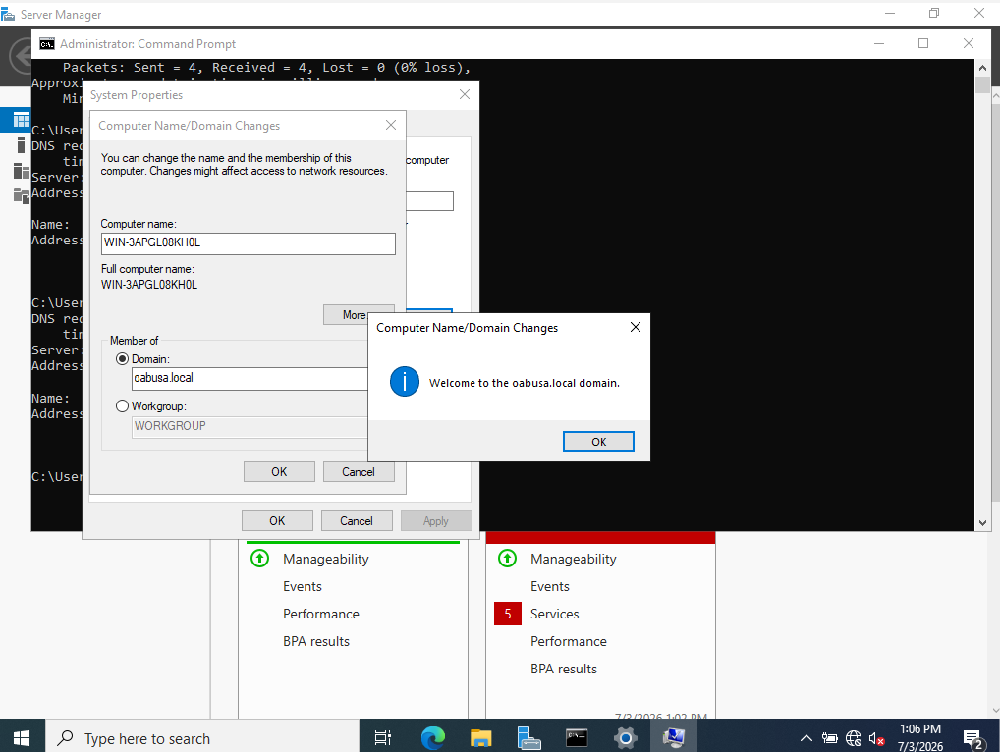
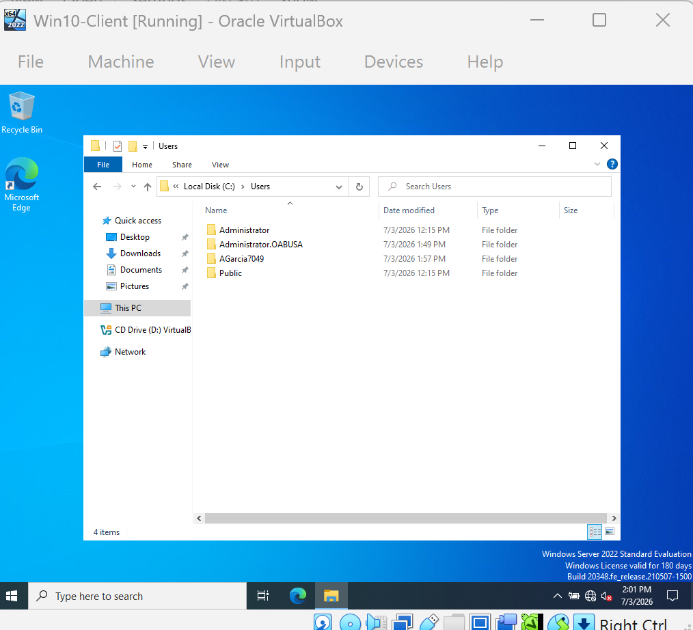
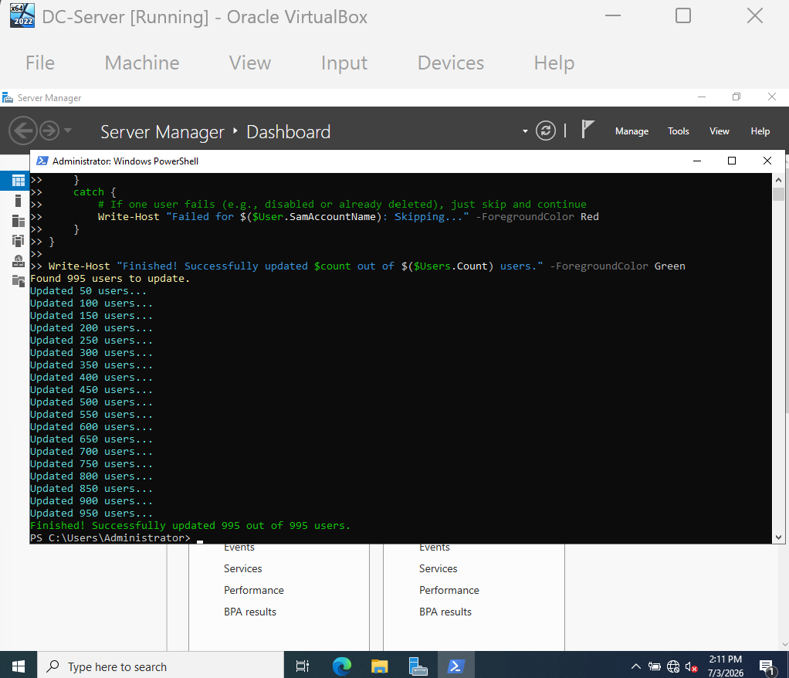
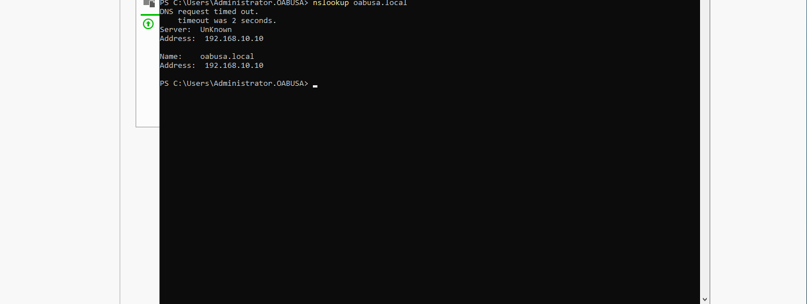
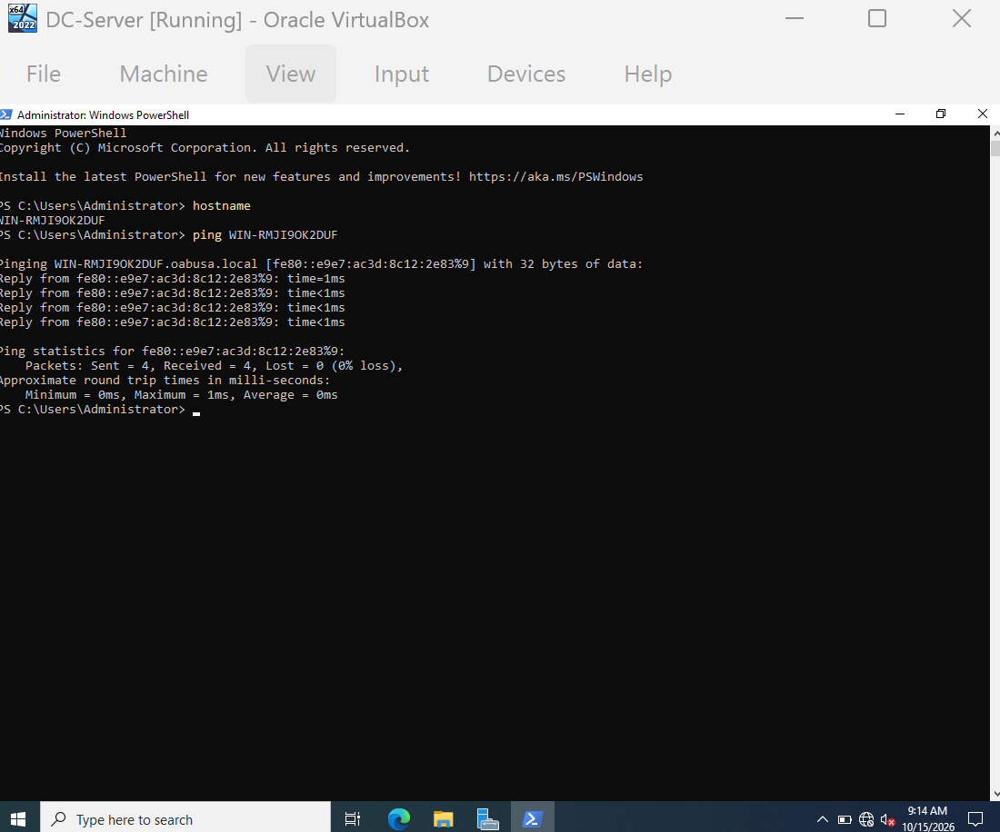

# Active Directory Enterprise Home Lab

A simulated corporate IT environment demonstrating hands-on skills in Windows Server administration, Active Directory, DNS, PowerShell automation, client integration, and network troubleshooting.

**Author:** [ReignMad](https://github.com/Reignmad)  
**Goal:** Build and document a functional enterprise-style domain from scratch to demonstrate skills relevant to Service Desk, IT Support, and Junior Systems Administration roles.

---

## 📖 Table of Contents

- [Business Scenario](#-business-scenario)
- [Skills Demonstrated](#-skills-demonstrated)
- [1. Infrastructure Setup](#️-1-infrastructure-setup)
- [2. Active Directory Configuration](#-2-active-directory-configuration)
- [3. Automation with PowerShell](#-3-automation-with-powershell)
- [4. Client Integration and Validation](#-4-client-integration-and-validation)
- [5. Bulk Maintenance and Troubleshooting](#-5-bulk-maintenance-and-troubleshooting)
- [6. Network Troubleshooting](#-6-network-troubleshooting)
- [Visual Proof](#-visual-proof)
- [Key Takeaways](#-key-takeaways)
- [Related Projects](#-related-projects)

## 📋 Business Scenario

Simulated a mid-sized company, **Oabusa Corp**, with six departments requiring centralized user management, secure authentication, automated onboarding, and reliable network connectivity.

**Departments:** IT, HR, Finance, Sales, Marketing, and Operations.

### Requirements

- Centralized user authentication
- Department-based access control
- Automated bulk user provisioning
- Reliable DNS resolution
- Secure domain-joined workstations
- Network connectivity troubleshooting

## 🛠️ Skills Demonstrated

| Category | Skills |
|---|---|
| Operating Systems | Windows Server 2022, Windows 10 |
| Identity and Access | Active Directory Domain Services (AD DS), DNS, Organizational Units (OUs), user and group management |
| Automation | PowerShell, bulk user provisioning, password resets, error handling |
| Virtualization | Oracle VirtualBox, internal networking, static IP configuration |
| Networking | TCP/IP, IPv4 addressing, DNS forwarding, DHCP concepts, network connectivity troubleshooting |
| Troubleshooting | Root-cause analysis, client domain-join issues, authentication failures, network connectivity |

## 🏗️ 1. Infrastructure Setup

### Virtualization Platform

**Tool:** Oracle VirtualBox 7.x

**Virtual machines:**

- **DC-Server:** Windows Server 2022 (64-bit), 8 GB RAM, 2 CPU cores, 50 GB storage
- **Win10-Client:** Windows 10 Pro workstation joined to the domain

### Network Configuration

Both virtual machines were configured on an internal network to simulate an isolated corporate LAN.

| Setting | Domain Controller | Client |
|---|---|---|
| IP address | `192.168.10.10` | `192.168.10.20` |
| Subnet mask | `255.255.255.0` | `255.255.255.0` |
| Default gateway | `192.168.10.1` | `192.168.10.1` |
| DNS | Domain controller DNS | `192.168.10.10` |

DNS forwarding was configured on the domain controller to support name resolution.

### Why This Matters

Static IP addressing keeps the domain controller reachable at a known address. Correct DNS configuration is essential for clients to locate domain services and is a common area of help desk troubleshooting.

## 🏢 2. Active Directory Configuration

### Domain Setup

- **Domain name:** `oabusa.local`
- **Domain controller:** Windows Server 2022 with the AD DS role installed

### Organizational Unit (OU) Design

Created six OUs to reflect a typical corporate structure.

| OU | Purpose |
|---|---|
| IT | IT staff and administrators |
| HR | Human Resources |
| Finance | Finance and accounting |
| Sales | Sales team |
| Marketing | Marketing team |
| Operations | Operations and support |

### Why This Structure?

Organizational Units help organize accounts and can be used to scope Group Policy settings and delegate administration. This structure provides a foundation for managing users by department.

## ⚡ 3. Automation with PowerShell

### Problem

Manually creating 1,000 user accounts would involve repetitive data entry, take significant time, and increase the chance of human error.

### Solution: `CreateUsers.ps1`

Created a PowerShell script to:

- Generate 1,000 user accounts using sample names, job titles, and phone numbers
- Randomly assign users to department OUs
- Set an initial password
- Display progress after every 100 users

### Example Script Logic

The following is an illustrative excerpt of the user-creation logic. The full script is available at [`scripts/CreateUsers.ps1`](scripts/CreateUsers.ps1).

```powershell
Import-Module ActiveDirectory

$FirstNames = @("James", "Mary", "John", "Patricia", "Robert", "Jennifer")
$LastNames = @("Smith", "Johnson", "Williams", "Brown", "Jones")
$OUs = @("IT", "HR", "Finance", "Sales", "Marketing", "Operations")

for ($i = 1; $i -le 1000; $i++) {
    $firstName = $FirstNames | Get-Random
    $lastName = $LastNames | Get-Random
    $ou = $OUs | Get-Random
    $username = "$($firstName.Substring(0,1))$lastName" + (Get-Random -Min 1000 -Max 9999)

    New-ADUser -Name "$firstName $lastName" `
        -SamAccountName $username `
        -UserPrincipalName "$username@oabusa.local" `
        -Path "OU=$ou,DC=oabusa,DC=local" `
        -AccountPassword (ConvertTo-SecureString "P@ssw0rd123!" -AsPlainText -Force) `
        -ChangePasswordAtLogon $false `
        -Enabled $true
}
```

> **Security note:** The password shown above is an example for a lab environment only. Do not reuse it in real systems. For a production-ready script, use secure credential handling, enforce password-change policies, validate unique usernames, and log errors.

### Result

**Reported outcome:** 1,000 user accounts created in minutes, demonstrating how automation can reduce repetitive administrative work.

### Why This Matters for Help Desk

Bulk provisioning is useful when onboarding many users, such as during seasonal hiring or organizational changes. This project demonstrates the use of scripting to make repetitive account-management tasks more efficient.

## 🖥️ 4. Client Integration and Validation

### Domain Join

- Joined `Win10-Client` to `oabusa.local`
- Verified DNS resolution from the client to the domain controller
- Tested authentication using domain credentials

### Validation Steps

| Test | Command or check | Expected result |
|---|---|---|
| DNS resolution | `nslookup oabusa.local` | Resolves to `192.168.10.10` |
| Network connectivity | `ping 192.168.10.10` | Replies received from the domain controller |
| Domain join | Windows domain-join confirmation | Client joins `oabusa.local` |
| Authentication | Sign in with a domain user | Domain login succeeds |

### Result

A domain-joined workstation with working authentication and DNS resolution.

## 🔧 5. Bulk Maintenance and Troubleshooting

### Case Study: Bulk Password Reset Failure

**Problem:** After running `BulkResetPasswords.ps1` to reset passwords for enabled users, the script reported 995 successful resets and 5 failures.

### Investigation

Used PowerShell to inspect account status:

```powershell
Get-ADUser -Filter * -Properties Enabled |
    Where-Object { $_.Enabled -eq $false }
```

### Root Cause

The five failed accounts required further investigation. Possible causes recorded during the lab included accounts that were disabled or had already been deleted from Active Directory.

### Solution

Added `try/catch` error handling to skip failed operations and report the affected accounts:

```powershell
try {
    Set-ADAccountPassword -Identity $user.SamAccountName `
        -Reset -NewPassword $newPassword
    $count++
}
catch {
    Write-Host "Failed for $($user.SamAccountName): Skipping..." -ForegroundColor Red
}
```

### Result

The script was rerun, with a reported 100% success rate for the active accounts targeted by the operation.

### Lesson Learned

Automation should account for failures rather than assume every operation will succeed. In a real support environment, I would verify account status, record errors, and follow up on unsuccessful resets.

Full script: [`scripts/BulkResetPasswords.ps1`](scripts/BulkResetPasswords.ps1)

## 🌐 6. Network Troubleshooting

### Scenario: DNS Failure and Connectivity Issues

Practised a systematic troubleshooting process for DNS and network connectivity issues that can prevent a workstation from locating domain resources.

### Baseline Checks

```powershell
# Review the client's IP configuration
ipconfig /all

# Verify DNS resolution for the internal domain
nslookup oabusa.local

# Test connectivity to the domain controller
ping 192.168.10.10
```

### Expected Results

| Command | Expected output |
|---|---|
| `ipconfig /all` | Client IP `192.168.10.20`; DNS server `192.168.10.10` |
| `nslookup oabusa.local` | Resolves to `192.168.10.10` |
| `ping 192.168.10.10` | Replies received, assuming ICMP is permitted and the host is reachable |

### Simulated DNS Failure and Recovery

1. **Introduce the issue:** Changed the client's DNS server to an invalid address, `10.0.0.99`.
2. **Verify the failure:** Ran `nslookup oabusa.local` and observed that DNS resolution failed.
3. **Correct the configuration:** Restored the DNS server to `192.168.10.10`.
4. **Flush the DNS cache:**

   ```powershell
   ipconfig /flushdns
   ```

5. **Confirm recovery:** Ran `nslookup oabusa.local` again and verified that it resolved to `192.168.10.10`.

### Why This Matters

DNS misconfiguration and connectivity problems can prevent users from accessing domain resources. This exercise demonstrates a structured approach: check the configuration, isolate the failure, correct the cause, and test again.

## 📸 Visual Proof

Place the screenshots in the repository's `screenshots/` folder using the filenames below. GitHub will display them in the README when the files exist at those paths.

| Step | Screenshot |
|---|---|
| VirtualBox VM configuration |  |
| Static IP configuration |  |
| OU structure |  |
| PowerShell user creation |  |
| User list in Active Directory |  |
| Domain join |  |
| Client login |  |
| Bulk password reset |  |
| DNS baseline check |  |
| Ping to domain controller |  |


## 🎯 Key Takeaways

- Built an enterprise-style domain lab from the ground up.
- Used PowerShell to automate the creation of 1,000 user accounts.
- Investigated bulk password-reset failures and added error handling.
- Joined a Windows client to the domain and validated authentication and DNS.
- Simulated a DNS configuration failure and documented recovery steps.
- Documented the environment as a technical knowledge base for IT support and junior systems administration roles.

## 🔗 Related Projects

- **Khumbulekhaya Stokvel Database** - SQL Server, T-SQL, and normalized database design
- **Plant Co. Sales Dashboard** - Power BI and DAX

---

This repository is my proof of work. Rather than only listing Active Directory on my CV, I built and documented an enterprise-style environment, automated user management, investigated failures, and practised structured network troubleshooting.
